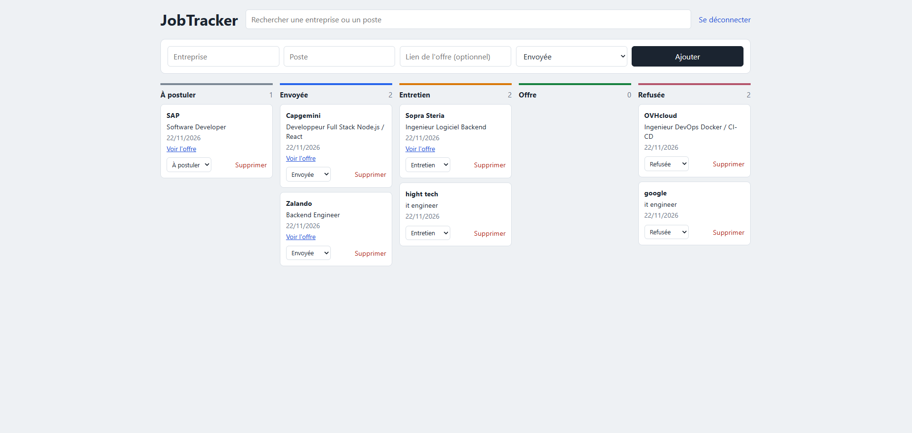

# JobTracker

A full-stack job application tracker. Add applications, follow them on a kanban board
(Wishlist → Applied → Interview → Offer → Rejected), search, and keep your data private behind JWT auth.

**Stack:** React 18 + TypeScript (Vite, TanStack Query) · Node.js + Express · PostgreSQL + Prisma · Zod · Docker Compose · GitHub Actions

**Live demo:** https://jobtracker-web.onrender.com _(free tier: the API sleeps after 15 min, the first request can take about a minute)_



## Run it (Docker, 3 commands)

```bash
cp .env.example .env        # then set JWT_SECRET (openssl rand -hex 32)
docker compose up --build
# open http://localhost:8080
```

## Run it locally (development)

```bash
# 1. Database
docker compose up db -d

# 2. API  (http://localhost:4000)
cd server
cp .env.example .env
npm install
npx prisma db push
npm run dev

# 3. Client  (http://localhost:5173, proxies /api to the API)
cd ../client
npm install
npm run dev
```

## Architecture

```
Browser ──> Nginx (client container, :8080)
              ├── /        static React build
              └── /api/*   reverse proxy ──> Express API (:4000) ──> PostgreSQL
```

- **Auth:** email + password (bcrypt), JWT in the `Authorization` header, 7-day expiry.
- **Validation:** every request body/query is validated with Zod; errors return `400` with field details.
- **Authorization:** every query is scoped by `userId`, so users can only read or modify their own data.

## API

| Method | Route | Description |
|--------|-------|-------------|
| POST | `/api/auth/register` | Create account, returns a token |
| POST | `/api/auth/login` | Log in, returns a token |
| GET | `/api/applications?status=&q=&page=&limit=` | List with filter, search, pagination |
| GET | `/api/applications/stats` | Count per status |
| POST | `/api/applications` | Create |
| PATCH | `/api/applications/:id` | Update (status, notes, …) |
| DELETE | `/api/applications/:id` | Delete |
| GET | `/api/health` | Health check |

## Tests & CI

```bash
cd server && npm test
```

GitHub Actions builds and tests the server, builds the client, and builds both Docker images on every push.

## Deploy on Render (free tier)

The repo includes a `render.yaml` Blueprint (PostgreSQL + API in Docker + static React site).

1. Push the repo to GitHub.
2. On Render: **New > Blueprint**, select the repo, and fill the two prompted variables:
   - `CORS_ORIGIN` = URL of the static site (e.g. `https://jobtracker-web.onrender.com`)
   - `VITE_API_URL` = URL of the API (e.g. `https://jobtracker-api.onrender.com`)
3. If Render adds a suffix to a service name, update these two variables with the real URLs and redeploy.

## Design decisions

- **Prisma `db push` in the container** keeps the demo to one command. For production, commit migrations
  (`prisma migrate dev`) and switch the container to `prisma migrate deploy`.
- **Single access token** keeps the auth flow simple; a refresh-token flow is a natural next step.
- **Nginx as reverse proxy** means the browser only talks to one origin (no CORS in production).

## Ideas for next steps

- Drag and drop between columns, notes and interview dates per application
- Refresh tokens + httpOnly cookies
- Integration tests with a real PostgreSQL service in CI
